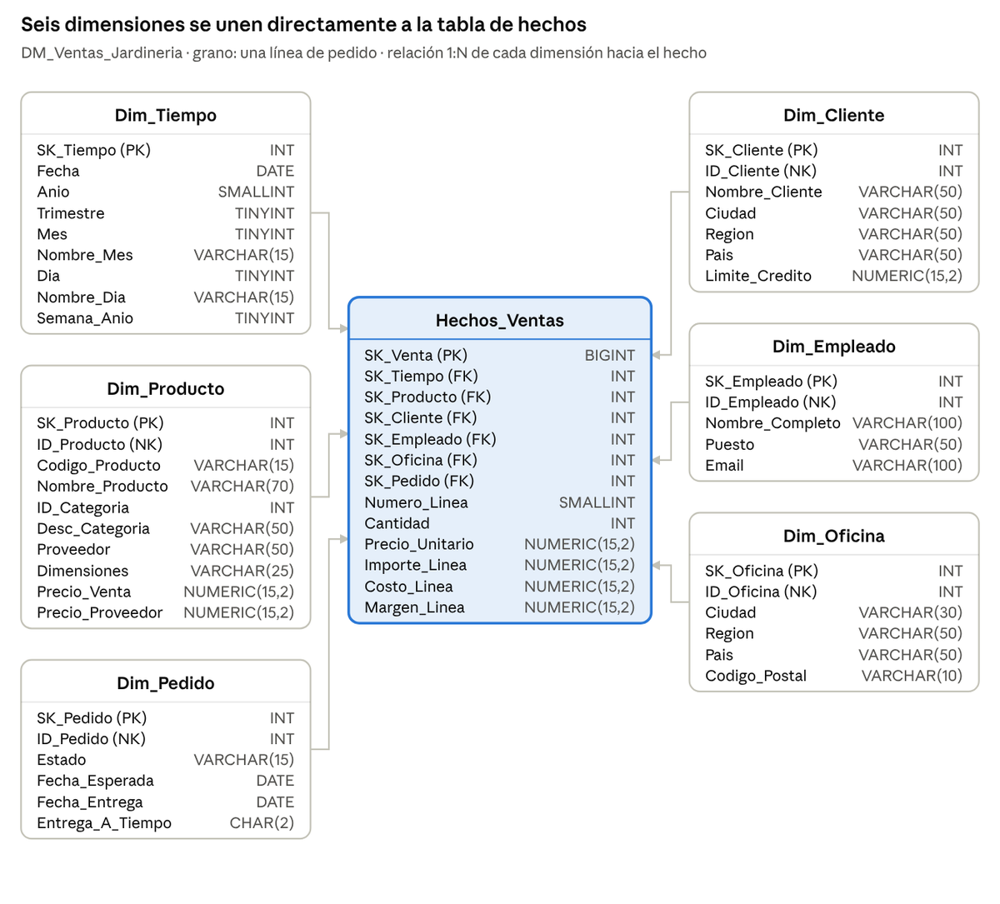

# EA1. Modelo estrella de un data mart

Diseño del modelo estrella para un data mart de ventas a partir de la base de datos **Jardinería**.

## Archivos

| Archivo | Contenido |
|---|---|
| `informe/EA1_Modelo_Estrella_Jardineria.pdf` | Informe de la evidencia: análisis de la base, preguntas de negocio, tabla de hechos, dimensiones y diagrama. |
| `diagramas/modelo_estrella_jardineria.png` | Diagrama del modelo estrella (tabla de hechos en el centro y seis dimensiones). |
| `scripts/jardineria_mysql.sql` | Script de la base Jardinería adaptado a MySQL Server 8.4 (MySQL Workbench). |

## Resumen del modelo

- **Grano:** una fila de la tabla de hechos = un producto dentro de un pedido (una línea de `detalle_pedido`).
- **Tabla de hechos:** `Hechos_Ventas`, con cantidad, precio unitario, importe, costo y margen de cada línea.
- **Dimensiones:** `Dim_Tiempo`, `Dim_Producto` (incluye la categoría), `Dim_Cliente`, `Dim_Empleado`, `Dim_Oficina` y `Dim_Pedido`.
- **Preguntas que responde:** producto más vendido, categoría con más productos y año con más ventas.
- La tabla `pago` queda por fuera porque su grano (pago por cliente) no coincide con el de las ventas.

