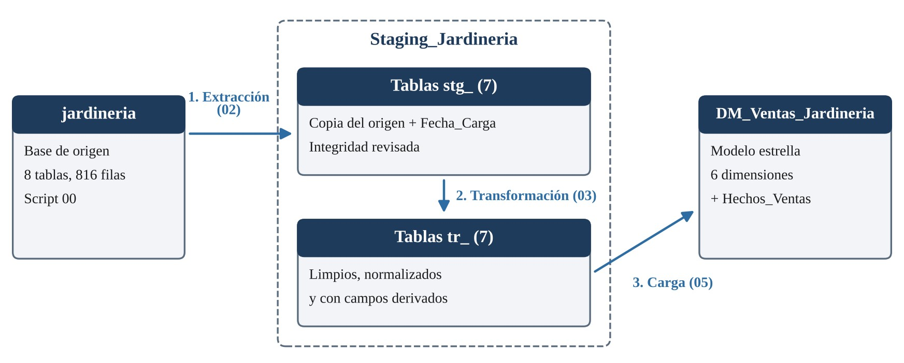
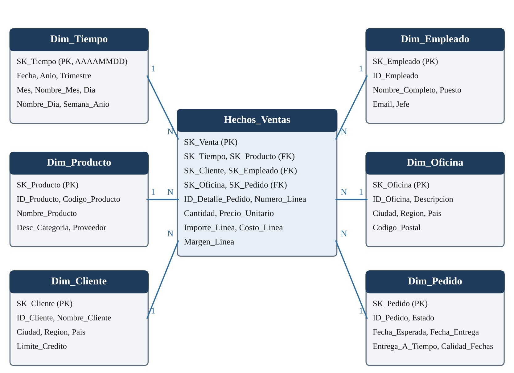

# EA3. Proceso de transformación de datos y carga en el data mart final

Proceso ETL completo: de la base de origen `jardineria` al staging `Staging_Jardineria` y de ahí al data mart `DM_Ventas_Jardineria` (modelo estrella).

## Archivos

| Archivo | Contenido |
|---|---|
| `informe/EA3_Proceso_ETL_Data_Mart.pdf` | Informe de la evidencia (con pantallazos de la ejecución). |
| `scripts/00_Origen_Jardineria.sql` | Base de origen: script oficial del curso (816 filas). |
| `scripts/01_Crear_Staging.sql` | Staging: tablas `stg_`, tablas `tr_`, bitácora y función `fn_LimpiarTexto`. |
| `scripts/02_Extraccion_Origen_a_Staging.sql` | Extracción del origen al staging. |
| `scripts/03_Transformacion_Staging.sql` | Limpieza, normalización, calidad y enriquecimiento. |
| `scripts/04_Crear_DataMart.sql` | Crea `DM_Ventas_Jardineria`: 6 dimensiones y `Hechos_Ventas`. |
| `scripts/05_Carga_DataMart.sql` | Carga del data mart con claves sustitutas. |
| `scripts/06_Validacion_y_Analisis.sql` | Validación contra el origen y consultas de análisis. |
| `scripts/07_Backups.sql` | Copias de seguridad de las tres bases. |
| `consultas/Consultas_Analisis_DataMart.sql` | Consultas SQL de análisis del data mart (producto más vendido, ventas por año, por oficina, etc.). |
| `diagramas/flujo_etl.png` | Flujo de datos del ETL. |
| `diagramas/modelo_estrella_final.png` | Modelo estrella final del data mart. |
| `fuente/CreacionJardineria.rar` | Script original entregado en el curso. |

## Orden de ejecución

`00` → `01` → `02` → `03` → `04` → `05` → `06` → `07` en SQL Server (`localhost\SQLEXPRESS`).
Espere a que cada script termine («Tiempo total de ejecución») antes de abrir el siguiente.

## Resultados principales

- 317 filas en `Hechos_Ventas`, 8.530 unidades y un importe de 217.038,00 (el origen tiene 318 líneas; la diferencia es una línea repetida que el ETL excluye).
- Producto más vendido: AR-009 Thymus Vulgaris (961 unidades). Categoría con más productos: Ornamentales (154). Año con más ventas: 2008.

