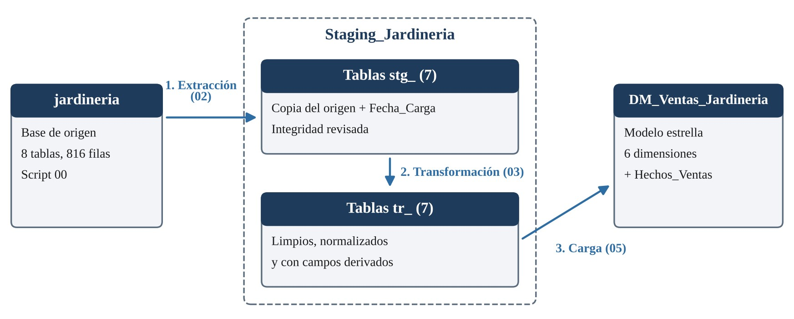

# Bases de Datos II — Proyecto integrador (EA4)

Repositorio con todas las evidencias del curso: el modelo estrella, la base de staging, el proceso ETL con el data mart final y las **pruebas de verificación de calidad de datos**. Todo el trabajo usa la base de datos **Jardinería** en SQL Server.

- **Institución:** Institución Universitaria Digital de Antioquia – IU Digital
- **Curso:** Bases de Datos II - PREICA2602B020061 (Grupo 3)
- **Docente:** Carolina Marquez Narvaez
- **Estudiante:** Andrés Felipe Murillo Cardona (`Andresm96`)

## Estructura de carpetas

```
bd2-integracion-final/
├── README.md                              ← este archivo
├── EA1_modelo_estrella/                   ← Evidencia 1: modelo estrella de un data mart
│   ├── informe/                           ← informe en PDF
│   ├── diagramas/                         ← diagrama del modelo estrella
│   └── scripts/                           ← script de la base Jardinería (MySQL)
├── EA2_staging/                           ← Evidencia 2: base de datos de staging
│   ├── informe/
│   ├── scripts/                           ← 00 a 04
│   └── BK/                                ← respaldo de las bases en script SQL
├── EA3_etl_data_mart/                     ← Evidencia 3: ETL y carga del data mart final
│   ├── informe/
│   ├── scripts/                           ← 00 a 07
│   ├── consultas/                         ← consultas SQL de análisis del data mart
│   ├── diagramas/                         ← flujo del ETL y modelo estrella final
│   └── fuente/                            ← script original del curso
├── pruebas_calidad_datos/                 ← Evidencia 4: pruebas de verificación de calidad
│   ├── 08_Pruebas_Calidad_Datos.sql       ← 30 pruebas en las tres capas
│   └── resultados/                        ← pantallazos y resumen de la ejecución
└── entrega_EA4/                           ← documento de entrega (portada + enlace)
```

## Evidencias

| Carpeta | Evidencia | Qué contiene |
|---|---|---|
| `EA1_modelo_estrella` | EA1. Modelo estrella de un data mart | Grano, tabla de hechos `Hechos_Ventas`, seis dimensiones y diagrama. |
| `EA2_staging` | EA2. Creación de una base de datos de staging | Base `Staging_Jardineria`, carga desde el origen, 24 validaciones y respaldos. |
| `EA3_etl_data_mart` | EA3. Proceso de transformación de datos y carga en el data mart final | ETL completo (extracción, transformación, carga), validación, análisis y backups. |
| `pruebas_calidad_datos` | EA4. Proyecto integrador | 30 pruebas de calidad de datos sobre el origen, el staging y el data mart. |

## Cómo cumple cada punto de la evidencia 4

| Instrucción | Dónde está en el repositorio |
|---|---|
| 1. Pruebas que determinen la calidad de los datos | `pruebas_calidad_datos/08_Pruebas_Calidad_Datos.sql` (30 pruebas en 8 dimensiones de calidad) y sus resultados en `pruebas_calidad_datos/resultados/`. |
| 2. Reunir informes, consultas SQL, scripts, diagramas y pruebas | Informes en `*/informe/`; scripts en `*/scripts/`; consultas SQL en `EA3_etl_data_mart/consultas/`; diagramas en `*/diagramas/`; pruebas en `pruebas_calidad_datos/`. |
| 3. Estructura de carpetas clara, con una carpeta para las pruebas de calidad | Una carpeta por evidencia (`EA1_…`, `EA2_…`, `EA3_…`) y la carpeta `pruebas_calidad_datos/`. |
| 4. Agregar los archivos al repositorio | Todos los archivos están versionados en Git y publicados en GitHub. |
| 5. Confirmar los cambios | Un commit por evidencia, en orden (ver el historial de commits). |

## Las tres bases del proyecto



| Base | Capa | Qué guarda |
|---|---|---|
| `jardineria` | Origen | Base transaccional del curso (8 tablas, 816 filas). |
| `Staging_Jardineria` | Staging | Copia del origen, datos limpios y transformados, y la bitácora del ETL. |
| `DM_Ventas_Jardineria` | Data mart | Modelo estrella final y la tabla `Calidad_Datos` con los resultados de las pruebas. |

## Cómo reproducir el proyecto

Requisitos: SQL Server (probado en SQL Server 2025 Express, servidor `localhost\SQLEXPRESS`, Windows Authentication) y Visual Studio Code con la extensión **SQL Server (mssql)**, o SQL Server Management Studio.

1. Ejecutar en orden los scripts `00` a `07` de `EA3_etl_data_mart/scripts`.
2. Ejecutar `pruebas_calidad_datos/08_Pruebas_Calidad_Datos.sql`.

Espere a que cada script termine antes de abrir el siguiente. Las copias `.bak` no se suben al repositorio porque se generan con el script `07_Backups.sql`.
